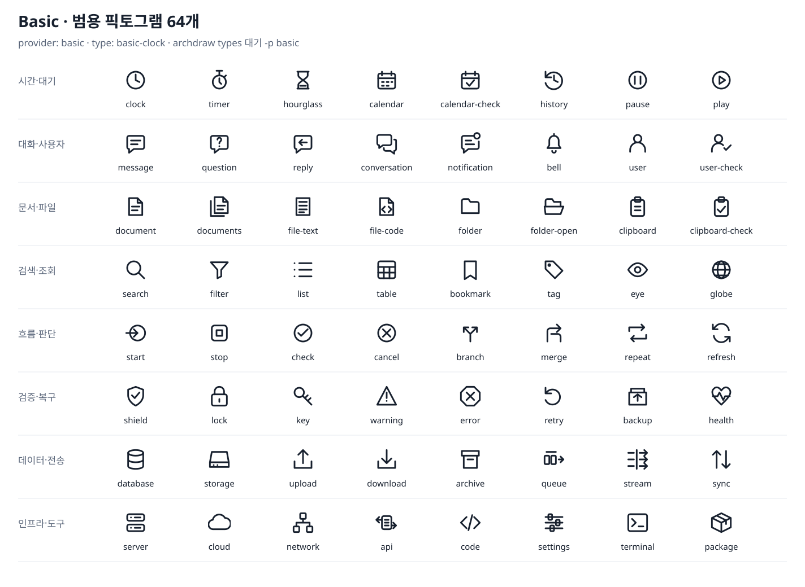

# @archdraw/icons-basic

[English](./README.md) · **한국어**

역할과 행동을 나타내는 범용 SVG 픽토그램 64개. 24 단위 격자, 둥근 1.75 단위 선으로 통일했고 다크 테마를 포함해 도면의 글자 색을 따른다. 직접 만든 자산과 코드는 MIT이며 벤더 로고가 아니다.



CLI에 포함된다. `provider: basic`, 서비스 아이콘과 섞으려면 `provider: aws,brands,basic`을 쓴다.

```bash
npx archdraw types 대기 확인 분기 오류 -p basic
```

```yaml
provider: basic
shape: card
nodes:
  - { id: wait, type: basic-clock, label: 확인 대기 }
  - { id: decide, type: basic-branch, label: 결과 분기 }
  - { id: fail, type: basic-error, label: 실패 }
```

아래 이름에 `basic-`을 붙이면 정식 type이다. 영어 별칭도 `basic-wait`, `basic-decision`, `basic-failure`처럼 접두사를 쓰고 `대기`, `확인`, `분기`, `실패` 같은 한국어 별칭도 지원한다. `types`는 영어·한국어 역할·분류 키워드로 검색한다. 접두사는 팩을 섞을 때 기존 클라우드·브랜드 slug를 덮어쓰지 않게 한다.

| 분류 | 이름 (각각 앞에 `basic-`) |
|---|---|
| 시간·대기 | clock, timer, hourglass, calendar, calendar-check, history, pause, play |
| 대화·사용자 | message, question, reply, conversation, notification, bell, user, user-check |
| 문서·파일 | document, documents, file-text, file-code, folder, folder-open, clipboard, clipboard-check |
| 검색·조회 | search, filter, list, table, bookmark, tag, eye, globe |
| 흐름·판단 | start, stop, check, cancel, branch, merge, repeat, refresh |
| 검증·복구 | shield, lock, key, warning, error, retry, backup, health |
| 데이터·전송 | database, storage, upload, download, archive, queue, stream, sync |
| 인프라·도구 | server, cloud, network, api, code, settings, terminal, package |

대기는 시계·모래시계, 사용자 확인은 user-check, 판단은 branch, 실패는 error를 고른다. 물음표는 실제 질문에 쓴다. 확인된 제품·벤더는 해당 팩의 공식 마크를 유지한다.

core·React에서 직접 조합하려면 별도 설치한다.

```bash
npm i @archdraw/core @archdraw/icons-basic
```

```ts
import { renderToSvg } from '@archdraw/core'
import { basicIcons, basicCategories } from '@archdraw/icons-basic'

const svg = await renderToSvg(source, { icons: basicIcons })
// 여러 팩: icons: [awsIcons, brandIcons, basicIcons]
console.log(basicCategories.time)
```

런타임 의존성이 없다. 구조 타입을 팩 내부에 복제하며 SVG에 외부 이미지·글꼴·id가 없다. 새 core는 `monochrome` 메타데이터로 테마 색을 적용하며, 이전 core는 이를 무시해 SVG 기본 색으로 보일 수 있다.
