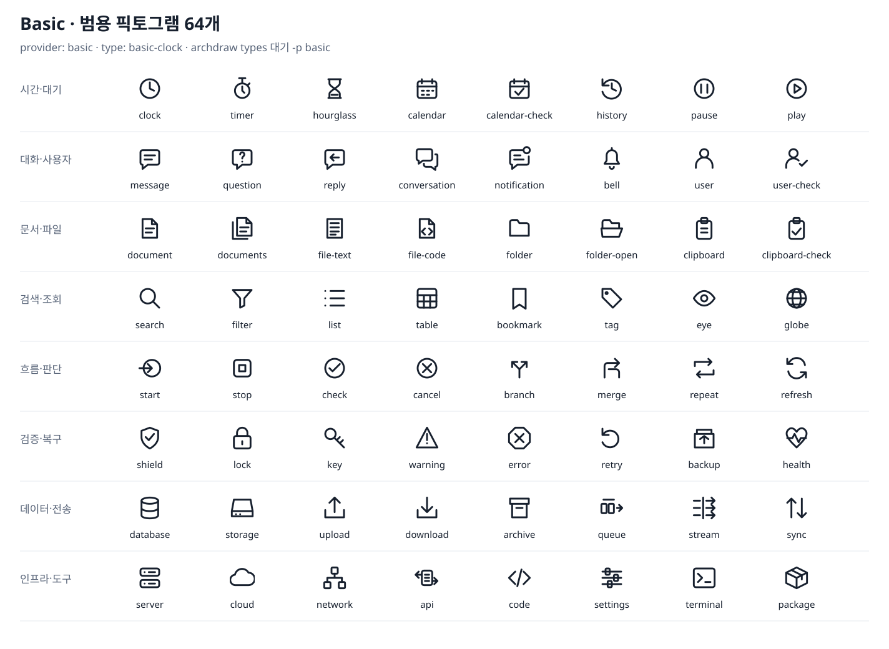

# @archdraw/icons-basic

**English** · [한국어](./README.ko.md)

64 original, vendor-neutral SVG pictograms for roles and actions. All use a 24-unit grid, rounded 1.75-unit strokes and the diagram's text colour, including dark themes. Assets and code are MIT; these are not vendor logos.



The CLI bundles this pack. Declare `provider: basic`, or combine it with `provider: aws,brands,basic`.

```bash
npx archdraw types wait confirmation 분기 오류 -p basic
```

```yaml
provider: basic
shape: card
nodes:
  - { id: wait, type: basic-clock, label: Await confirmation }
  - { id: decide, type: basic-branch, label: Result decision }
  - { id: fail, type: basic-error, label: Failure }
```

Every name below takes the `basic-` prefix. English aliases are prefixed too (`basic-wait`, `basic-decision`, `basic-failure`). Korean aliases such as `대기`, `확인`, `분기`, `실패` also resolve. Search matches role/category keywords in English and Korean. Prefixes keep the pack from shadowing existing cloud/brand slugs when packs are combined.

| Category | Names (prefix each with `basic-`) |
|---|---|
| Time | clock, timer, hourglass, calendar, calendar-check, history, pause, play |
| People | message, question, reply, conversation, notification, bell, user, user-check |
| Documents | document, documents, file-text, file-code, folder, folder-open, clipboard, clipboard-check |
| Discovery | search, filter, list, table, bookmark, tag, eye, globe |
| Workflow | start, stop, check, cancel, branch, merge, repeat, refresh |
| Reliability | shield, lock, key, warning, error, retry, backup, health |
| Data | database, storage, upload, download, archive, queue, stream, sync |
| Infrastructure | server, cloud, network, api, code, settings, terminal, package |

Choose the action being represented: clocks/hourglasses for waiting, user-check for confirmation, branch for decisions, error for failure. A question mark is for an actual question. Keep confirmed vendor/product marks from their own pack.

Core and React callers install the pack separately:

```bash
npm i @archdraw/core @archdraw/icons-basic
```

```ts
import { renderToSvg } from '@archdraw/core'
import { basicIcons, basicCategories } from '@archdraw/icons-basic'

const svg = await renderToSvg(source, { icons: basicIcons })
// Or icons: [awsIcons, brandIcons, basicIcons]
console.log(basicCategories.time)
```

There are no runtime dependencies. Structural types are copied locally, and SVGs contain no external images, fonts or ids. A matching core renderer honours the optional `monochrome` flag; older core versions ignore it and may use the SVG default colour.
